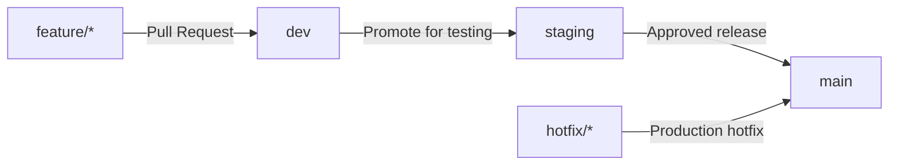

# Git Branching Workflow

This project follows a professional Git workflow built around the `main`, `dev`, `staging`, and `feature/*` branches. A separate `develop` branch is not needed — the `dev` branch serves that purpose.

## Branch Flow



## Branch Purposes

| Branch      | Purpose                                              |
|-------------|------------------------------------------------------|
| `main`      | Live production code                                 |
| `dev`       | Development and feature integration                  |
| `staging`   | Final testing before production deployment           |
| `feature/*` | Isolated development of a single feature             |
| `hotfix/*`  | Urgent production bug fixes                          |

## Workflow Steps

1. Create a feature branch from `dev`, e.g. `feature/login-api`.
2. Develop the feature and merge it into `dev` through a GitHub Pull Request.
3. Once tests pass on `dev`, promote the changes to `staging` and test them on the staging server.
4. After testing is approved, release from `staging` to `main`.
5. Deploy to production from the `main` branch.

### Example Commands

```bash
# 1. Create a feature branch from dev
git checkout dev
git pull origin dev
git checkout -b feature/login-api

# 2. Commit and push your work, then open a Pull Request into dev on GitHub
git add .
git commit -m "feat: add login API"
git push -u origin feature/login-api
```

## Hotfixes

If an urgent bug is found in production, create a `hotfix/*` branch from `main` and merge the fix into `main`. Then merge the same fix into `staging` and `dev` as well.

```bash
git checkout main
git pull origin main
git checkout -b hotfix/fix-payment-bug
```

## ⚠️ Important

If changes that exist only on `staging` (or any hotfixes) reach production, make sure to sync them back into `dev`. Otherwise, conflicts may occur in the next release.

## CI/CD

The existing GitHub Actions workflow can be configured to match this branch flow (e.g. `dev` → run tests, `staging` → deploy to staging, `main` → deploy to production).
